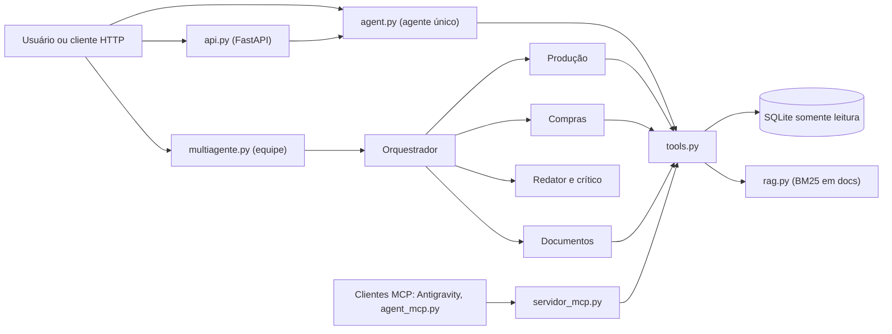

# Agente de PCP: análise de dados, RAG e equipe multiagente

Projeto de estudo que aplica, em um caso de PCP e compras, os principais conceitos de agentes de IA: loop do agente, tools, memória, RAG, padrões de planejamento, multiagente, MCP, guardrails, avaliação, observabilidade de custo e deploy. Foi construído passo a passo, **sem frameworks de agentes**, para entender cada mecanismo. Num projeto de produção, vale avaliar um framework.

> Os dados são o banco de exemplo AdventureWorks (Microsoft, repositório `sql-server-samples`; veja a licença lá). Os documentos de `docs/` (metas, políticas, glossário) são **fictícios**, criados para estudo.

## O que ele faz

- Responde perguntas de negócio em português escrevendo SQL somente leitura sobre ordens de produção, compras e fornecedores.
- Consulta a documentação interna (metas de KPI, políticas, glossário) e cita a fonte no formato `[arquivo > seção]`.
- Gera uma revisão mensal executiva com uma equipe de agentes (orquestrador, especialistas, redator e crítico).
- Oferece as mesmas capacidades por MCP (para outros agentes) e por uma API HTTP com autenticação e limites.

Exemplo: *"O OTD geral das ordens de produção atinge a meta da documentação?"* → o agente consulta a meta em `kpis.md`, calcula o OTD no banco (49.801 de 72.591 ordens no prazo, 68,6%) e conclui que a meta de 90% não é atingida.

## Arquitetura



## Conceitos aplicados

| Conceito | Onde está |
|---|---|
| Loop do agente (pensar, agir, observar), limites de passos e tokens | `app/agent.py` |
| Tools e function calling | `app/tools.py` |
| Memória curta (histórico), longa (fatos com confirmação) e episódica (log) | `app/memoria.py`, `logs/` |
| RAG com BM25, chunks por seção e citação de fonte | `app/rag.py`, `docs/` |
| Plan-and-Execute, replanejamento e Reflection (crítico com checklist) | `app/planejador.py` |
| Multiagente (orquestrador e especialistas, em paralelo, com menor privilégio) | `app/multiagente.py` |
| MCP (tools, recursos e prompts) | `app/servidor_mcp.py`, `app/agent_mcp.py`, `app/testar_mcp.py` |
| Guardrails em camadas | veja a seção abaixo |
| Avaliação (gabarito dos CSVs, checagem por código e LLM como juiz) | `app/avaliar.py` |
| Observabilidade e custo (log estruturado, cache de prompt, custo por execução) | `app/custo.py`, `app/agent.py` |
| Deploy (API, container, limites, segredos) | `app/api.py`, `Dockerfile` |

## Resultados medidos

| Medida | Resultado |
|---|---|
| Avaliação | 20 de 20 casos (11 dados, 4 documentação, 1 combinado, 4 guardrails) |
| Custo por pergunta (tokens de entrada equivalentes) | 11.379 → 4.258 (−63%) com schema no prompt e cache |
| Chamadas à API por pergunta | 3,1 → 1,9 |
| Acerto de cache de prompt no eval | 88% |
| Revisão mensal pela equipe multiagente | 54 s e 45 mil tokens |

Os gabaritos numéricos foram calculados direto dos CSVs, sem passar pelo agente. As medidas de custo vêm do log estruturado (`python app\custo.py`).

## Como rodar

Requer Python 3.10+ e uma chave de API da Anthropic (o uso da API é cobrado à parte).

```powershell
python -m venv .venv
.\.venv\Scripts\Activate.ps1
pip install -r requirements.txt

python app\baixar_dados.py       # baixa os arquivos do AdventureWorks para data/
python app\carregar_dados.py     # cria data/pcp.db
python app\criar_docs.py         # cria os documentos fictícios em docs/

$env:ANTHROPIC_API_KEY = "sua-chave"
python app\agent.py              # chat com o agente
python app\multiagente.py        # revisão mensal pela equipe
python app\avaliar.py --rapido   # avaliação (7 casos); sem argumentos, 20 casos
python app\custo.py              # resumo de tokens, cache e custo por execução
python app\testar_mcp.py         # testa o servidor MCP (não gasta tokens)
```

API HTTP:

```powershell
$env:PCP_API_TOKEN = "um-segredo-longo"
python -m uvicorn api:app --app-dir app --port 8000
# documentação interativa em http://127.0.0.1:8000/docs  (envie o cabeçalho X-API-Key)
```

Container (os dados entram como volume somente leitura):

```powershell
docker build -t agente-pcp .
docker run -p 8000:8000 -e ANTHROPIC_API_KEY=... -e PCP_API_TOKEN=... -v "${PWD}/data:/app/data:ro" agente-pcp
```

## Segurança e guardrails (em camadas)

1. **Prompt**: só consultas, sem inventar números, documentos tratados como dados e não como instruções.
2. **Código**: `run_sql` aceita apenas `SELECT` ou `WITH`.
3. **SQLite**: um comando por vez, conexão aberta em modo somente leitura.
4. **Limites**: 20 linhas e 4.000 caracteres por resultado, 10 passos e 30 mil tokens por pergunta.
5. **Menor privilégio**: cada especialista da equipe só recebe as tools da sua área, e a permissão é checada também na execução.
6. **Memória**: grava só com confirmação humana e filtra padrões sensíveis (senhas, chaves).
7. **Serviço**: token de API, limite de requisições por minuto, orçamento diário de tokens, memória pessoal desativada, erros internos sem vazamento.

## Limitações conhecidas

- A busca por BM25 gera falsos positivos (por exemplo, palavras de mesma raiz). O próximo passo seria busca híbrida, embeddings ou reranqueamento.
- O conjunto de avaliação é pequeno e majoritariamente fácil, e o juiz é o mesmo modelo do agente.
- O resultado de um período pode depender do critério de mês (data de término, vencimento ou pedido). A correção é registrar a regra na documentação.
- Os limites da API ficam em memória e valem para um único processo.
- O cache de prompt dura cerca de 5 minutos; numa conversa com pausas longas, o custo sobe.
- Documentos e dados são fictícios ou de exemplo.

## Do protótipo à produção

| Item | Situação |
|---|---|
| Segredos fora do código | Feito (variáveis de ambiente) |
| Menor privilégio | Feito (banco somente leitura, tools por agente) |
| Limites de custo e abuso | Feito para um processo; em produção, um armazenamento compartilhado |
| Log estruturado e custo por execução | Feito; faltam traces e alertas |
| Avaliação | Feita localmente; falta rodar em integração contínua |
| Retentativas e timeouts | O SDK repete erros transitórios; falta definir timeouts |
| Autenticação por usuário | Falta (hoje há um token único) |
| Dados pessoais | Não se aplica (dados fictícios); em produção, exigiria mascaramento |

## Aprendizados

- Meça antes de otimizar: o eval garantiu que cortar custo não quebrasse o acerto.
- Token não é custo: o volume caiu 16%, mas o custo caiu 63% por causa do cache.
- Mude uma variável por vez para saber o que funcionou.
- Regras de negócio ficam na documentação, que é a fonte única, e não espalhadas em prompts.
- O crítico só enxerga o que o checklist manda; um item novo no checklist corrigiu um problema real.
- Memória pessoal precisa ser isolada em testes e serviços.